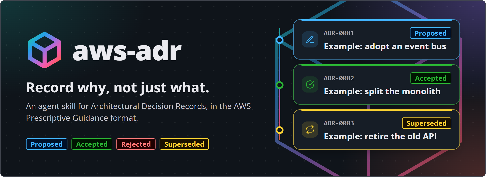

<h1 align="center"></h1>

<p align="center">
<a href="#install"><picture><source media="(prefers-color-scheme: dark)" srcset="assets/nav-install-dark.webp"></picture></a>
<a href="#what-is-an-adr"><picture><source media="(prefers-color-scheme: dark)" srcset="assets/nav-what-dark.webp"></picture></a>
<a href="#lifecycle"><picture><source media="(prefers-color-scheme: dark)" srcset="assets/nav-lifecycle-dark.webp"></picture></a>
<a href="#the-aws-adr-format"><picture><source media="(prefers-color-scheme: dark)" srcset="assets/nav-format-dark.webp"></picture></a>
</p>

**An [agent skill](https://skills.sh/) that teaches Claude (or any compatible coding agent) to create and maintain Architectural Decision Records using the format and lifecycle from the [AWS Prescriptive Guidance: Architectural Decision Records](https://docs.aws.amazon.com/prescriptive-guidance/latest/architectural-decision-records/) guide.**

## Install

```bash
npx skills add the-khiem7/aws-adr
```

Update later to pull the latest version from this repo:

```bash
npx skills update aws-adr -g
```

Once installed, the skill activates automatically whenever you ask your agent to write an ADR, start a decision log, or move an ADR through review, acceptance, rejection, or supersession. You can also invoke it directly with `/aws-adr` in an interactive session.

## What is an ADR

An Architectural Decision Record documents a single significant choice made about a software architecture: the context that made the decision necessary, the decision itself, and its consequences. A project's ADRs together form its decision log, a running history that lets anyone, including someone who joins the project years later, understand not just what the architecture looks like today but why it looks that way.

AWS's guidance says to write an ADR for decisions about structure, non-functional requirements, dependencies, interfaces, and construction techniques, and to skip it for routine detail.

<picture><source media="(prefers-color-scheme: dark)" srcset="assets/when-to-adr-dark.webp"></picture>

## Lifecycle

An ADR starts as `Proposed`, the team reviews it, and the owner then marks it `Accepted` or `Rejected`. Once accepted or rejected, an ADR is immutable - a later change in direction gets written as a brand new ADR, which, once accepted, marks the old one `Superseded` rather than editing it in place.

<picture><source media="(prefers-color-scheme: dark)" srcset="assets/lifecycle-dark.webp"></picture>

## The AWS ADR format

Every ADR in this format uses the same eight sections, in the same order. Compliance and Notes are optional.

<picture><source media="(prefers-color-scheme: dark)" srcset="assets/anatomy-dark.webp"></picture>

<details>
<summary>The eight sections as a table</summary>

| Section      | Purpose                                                                                           |
| ------------ | ------------------------------------------------------------------------------------------------- |
| Title        | Names the decision, not the problem.                                                              |
| Status       | `Proposed`, `Accepted`, `Rejected`, or `Superseded by ADR-NNNN`.                          |
| Date         | The date the status last changed.                                                                 |
| Context      | The technical, business, and team constraints that make the decision necessary, stated neutrally. |
| Decision     | The choice made, stated as an active commitment ("We will...").                                   |
| Consequences | The results of the decision, split into `Positive:` and `Negative:` lists.                     |
| Compliance   | Optional. Concrete, checkable rules that follow from the decision.                                |
| Notes        | Optional. Author, version, and a changelog.                                                       |

</details>

## Source

Built from the AWS Prescriptive Guidance ADR guide:

- [Overview and process](https://docs.aws.amazon.com/prescriptive-guidance/latest/architectural-decision-records/adr-process.html)
- [Appendix: example ADR](https://docs.aws.amazon.com/prescriptive-guidance/latest/architectural-decision-records/appendix.html)

This is an independent project and is not affiliated with or endorsed by Amazon Web Services. The visual style uses the open-source [Cloudscape](https://cloudscape.design/) design tokens. The cube mark is adapted from the AWS favicon; AWS and its marks are trademarks of Amazon.com, Inc. or its affiliates.

